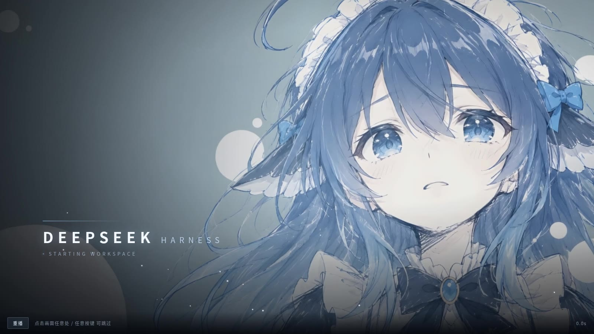

# dsh-splash-fish

把一张自己的插画做成 DeepSeek Harness 的开屏动画：从黑场里显影，人物为动态效果，然后淡出进工作区。

<p align="center"></p>
图显示不出来是 GitHub 图片代理的问题，可以直接看 preview/splash-25d-preview.mp4

- [`preview/splash-25d-preview.mp4`](preview/splash-25d-preview.mp4) 完整启动动画，5.07 秒
- [`preview/hair_wave_preview.mp4`](preview/hair_wave_preview.mp4) 上一版的头发位移层，3.6 秒，留着对照
- `preview.html` 用浏览器直接打开就能看，加 `?t=2600` 可以冻在某一帧

纯客户端插件，挂在 `shell.overlay` 槽位上，每次页面加载只播一次，播完自己卸载，等不及就点一下屏幕、按任意键、或者滚一下滚轮，立刻进收尾——急着开始干活的时候不用干看着。那一下点击会被吃掉，不会漏到下面的界面上。

## 这几个地方和常见的开机动画不一样

**dsh 自带的那张启动图，我给它压掉了。** dsh 启动时会先画一张：HARNESS、转圈、Loading plugins。不少同类插件在 README 里直接写了压不住它，动画前面总要闪一下。我没走客户端那条路——客户端插件被实例化的时候，那张图早就画完了，追不上。我用 `webserver/index-inject` 在 index.html 解析阶段就把封面铺上去，比任何客户端插件都早。

**头发是渲染出来的，不是 CSS 平移。** 单张图里头发和脸是同一批像素，CSS 平移等于连脸一起拽。这里是离线算的：深度图决定每个像素该动多少，发根到发梢的权重让幅度递增，再叠空间相位和高频湍流。算完 108 帧，编码成带 alpha 的 VP9 WebM。

**运行时不花算力。** 那 108 帧压成一个 1MB 的视频，启动时就是播一段视频。没有逐帧计算，没有 canvas，占用和播普通视频一样。

**播完不挡鼠标。** 动画层挂在 `body` 下面、z-index 2147483600，能盖住第三方浮层；`pointer-events: none` 加上残留清理，播完立刻能操作界面。

## 安装

**有 dsh 桌面版就能装**——Windows 和 Mac 都行。Mac 上那两个 `.bat` 用不了，换成 python 命令，[AGENTS.md](AGENTS.md) 里写了。

**让Agent装**：一句话就够。
```
帮我安装这个 DeepSeek Harness 插件：https://github.com/Streamfish-lab/dsh-splash-fish
```

Agent 拿到链接会自己去仓库里翻 AGENTS.md，那里写了具体步骤。一般来说只发了这一句就可以装好。

如果它卡住、或者装完没反应，再把下面这段一起发过去。

> ⚠️ **装的时候不要手改 `profiles\desktop\package.json`。** 那是 dsh 的启动配置，一个逗号写错、或者 Windows 路径的反斜杠没转义，dsh 就再也起不来了，报 `Unexpected token ... is not valid JSON`。已经有人踩过这个坑。用应用自带的"设置 → 插件 → 添加插件"，让应用自己写配置。

这里面的重点是 desktop 版不能用命令行 `dsh plugin add`——那个 profile 是 Electron 独占的，会直接被拒，不知道这点会白试很久：

```
帮我安装这个 DeepSeek Harness 插件：https://github.com/Streamfish-lab/dsh-splash-fish

1. 克隆到 %USERPROFILE%\.dsh\bundles\dsh-splash-fish
   （目录要长期留着，插件是 link 引用的，移走就失效）
2. 装的时候走应用界面，不要手改配置文件：
   设置 → 插件 → 添加插件，填上一步那个路径
3. 告诉我需要彻底退出应用再打开
```

细节写在 [AGENTS.md](AGENTS.md) 里，Agent 会自己看。

**自己装**：设置 → 插件 → 添加插件，填仓库目录的绝对路径（要指到有 `package.json` 那一层），装完重启。

**命令行**（Web 版或者装了 dsh CLI）：

```bash
dsh plugin --profile web add /你的绝对路径/dsh-splash-fish
```

桌面版不要用命令行，`desktop` 这个 profile 是 Electron 独占的，`dsh plugin` 会直接拒绝。

<details>
<summary>技术细节：为什么做成视频、接入时踩过的坑、层级问题（不关心可以跳过）</summary>

### 为什么做成视频

一开始我用纯 CSS 做，让头发那块区域平移几个像素。效果很差，因为单张图里头发和脸是同一批像素，平移就等于连着脸一起拽，看着像有人在扯纸片。

后来改成离线渲染：用深度图算每个像素该移动多少，近的动得多、远的动得少；再用发根到发梢的权重控制幅度递增；加上空间相位让波形扫过去，加一层高频湍流让区域内部也发生形变。渲染 108 帧，编码成 WebM，运行时当视频层播放。

位移公式，参数都在 `06_render_25d.py` 顶部：

```
amp = A_BASE + A_DEPTH·depth + A_HAIR·hairWeight
φ   = 2π(PHASE_U·u + PHASE_V·v)
dx  = amp·(0.62·sin(2πf₁t+φ) + 0.38·sin(2πf₂t−0.7φ)) + A_TURB·turb·sin(2πf₃t+2.1φ)
```

所有波走整数个周期，再减掉 t=0 时的相位偏置，这样首帧和末帧的位移都正好是 0。视频播完直接摘掉，画面不会跳。

#### 接入时踩到的三个坑

**视频得跟底图一起缩放。** `.sf-bg` 上有 `sfFocus`（1.14 缩到 1.02）和 `sfDrift`（1.02 到 1.06）两条动画，还有模糊。视频如果作为兄弟节点放进去，4.3 秒时底图已经是 1.06 倍而视频还是 1 倍，头发会飘到脸外面。解决办法是把 `<video>` 塞进 `.sf-bg` 内部，子元素会继承父节点的 `transform` 和 `filter`。

**插件没有打包器。** `client.js` 是被 `__ModuleLoader__.load()` 直接执行的，没有 webpack，也没有 `import.meta.url`，包目录里的 webm 根本引用不到。只能把视频转成 base64 内联，运行时 `atob` 再 `Blob` 再 `createObjectURL`。不要直接用 `data:` 当 `video.src`，那个有长度限制，而且有些 Chromium 版本对 data URI 的视频不带 alpha。

**视频 3.6 秒，时间轴 4.4 秒。** 播完以后停在最后一帧，如果那帧头发还飘着，后面 0.8 秒就定格在一个歪掉的位置。所以渲染时必须保证首尾位移是 0，播完摘掉才看不出来。

#### 不闪 dsh 自带的启动画面

dsh自带的启动画面（`[data-dsh-boot]`，HARNESS 加转圈加 Loading plugins）在任何客户端插件被实例化之前就画好了，光靠 client 半边怎么都追不上。

能用的是 `webserver/index-inject`，它收集的注入行会在 index.html 解析阶段就渲染。`lib/index.js` 推了两行：一条样式铺同色封面，一条脚本负责在 client 挂载时把封面摘掉，另外设了 3.5 秒的兜底。

几个要注意的地方，都是试出来的：只推 `style` 和 `script` 两种（行类型是闭集，写个不认识的导致 boot gate reject，桌面端会进崩溃恢复页）；`style` 必须排在 `script` 前面；订阅要同步注册，因为注入表只在启动时收集一次；`tapIndex` 在桌面端没用，那边走 `dsh-app://` 直接读 index.html，不经过 web 服务器。

#### 层级

`shell.overlay` 槽位的包装层 z-index 只有 20，祖先带 `transform` 之类就会创建层叠上下文，后代写多大的数都被锁在里面。所以动画层是自己建节点挂到 `body` 下面的，z-index 用 `2147483600`。

挂到 body 之后要小心一件事：不能挡住界面。现在 `.sf-root` 和 React 那个空壳都设了 `pointer-events: none`，挂载前会清理残留节点，播完还有一道 1.2 秒的强制清理定时器。

</details>

## 换成自己的图（可选）

默认那张插画是别的画师的作品。要换也可以，但代价得说清楚：**换完以后头发那层飘动就没了**——它是照着这张图单独算出来的，换图必须重算。

只要画面能显影、不在乎飘动，把图拖到 `换自己的图.bat` 上松手就行（Mac 上跑 `python3 tools/make_from_image.py 我的图.jpg`）。它会居中裁成 16:9、缩到 1600×900、重新打包，几分钟的事。出来的画面里显影、光晕、光扫、粒子、淡出都在，只是没有发丝飘动。

想要新的飘动，得跑一遍离线渲染——装 Python、torch、SAM2 权重，按 `hair/tools/` 里的顺序重新算，一小时上下看机器。

<details>
<summary>想要头发飘动：需要跑一遍离线渲染（要 Python、torch、SAM2 权重）</summary>

这一层是离线算出来的，需要跑完整个渲染流程：

```bash
pip install opencv-python numpy scipy
pip install transformers                       # 深度图，可选

python3 hair/tools/05_depth.py --image assets/splash.webp --out hair/masks/depth.png
python3 hair/tools/01_sam2_hair_mask.py --image assets/splash.webp --out hair/masks/hair_mask.png
python3 hair/tools/02_make_weight.py --mask hair/masks/hair_mask.png --out hair/masks/hair_weight.png
python3 hair/tools/06_render_25d.py
bash hair/tools/04_encode_webm.sh hair/frames25d assets/wall_25d.webm
python3 build.py
```

第一步的深度图需要 `transformers`，装不上会自动退回用亮度凑一张。第二步的 SAM2 需要 torch 和权重 `sam2.1_hiera_large.pt`。

说清楚一点：仓库里现在这张 mask 是凑出来的，不是 SAM2 的输出。生成的时候手上没有 GPU 环境，用的是椭圆约束加颜色阈值再挖掉脸和肩膀。发丝之间的空隙是糊的。你要是自己跑一遍 `01_sam2_hair_mask.py` 换掉它，边缘会好很多。

</details>

## 更新

**不会自动更新。** 装在本地的那一份就是当时那份，dsh 不会去仓库检查新版。

**git clone 装的**：

```bash
cd %USERPROFILE%\.dsh\bundles\dsh-splash-fish
git pull
```

然后彻底退出 dsh 再打开。

**下载压缩包装的**：重新下一份覆盖。解压时别选"清空目标文件夹"，`assets\` 那几 MB 得留着，构建要用。

**换成自己图的人注意**：更新会用新版的 `client.js` 覆盖你现在这个，画面回到默认。重新拖一次图就能换回来。

**怎么知道有没有新版**：[Releases](https://github.com/Streamfish-lab/dsh-splash-fish/releases) 页面。

## 版本历史

| 版本 | 改了什么 |
|---|---|
| v0.1.0 | 第一版，纯 CSS 动画 |
| v0.2.0 | 换成深度图驱动的 2.5D 位移，顺便解决启动闪烁 |
| v0.2.1 | 动画层改挂到 body 下面，压住第三方浮层 |
| v0.2.2 | 顶部加压暗带，想盖住 Windows 的窗口按钮 |
| v0.2.3 | 修掉动画层拦截点击的问题，删掉压暗带 |
| v0.3.0 | 收尾时序：视频循环、掐掉 animation 干扰、整层同步淡出，不再露出 dsh 的加载页 |

细节见 [CHANGELOG.md](CHANGELOG.md)。

## 还没解决的问题

- 皮肤和纯色背景这种没有纹理的地方，位移 9 像素在数值上只差一两个灰度级，肉眼看不出在动。这是整图位移本身的上限，调参数解决不了。
- Windows 右上角那三个窗口按钮是系统画的，网页盖不住。想彻底解决只能把 dsh 切到 advanced 窗口模式，那样标题栏是透明的。
- 只播一次，想重播要刷新页面。
- dsh 还是 developer preview，`shell.overlay` 和 `slots.register` 的接口说不定哪天就变了。

<details>
<summary>目录结构</summary>

```
dsh-splash-fish/
├── package.json          插件声明
├── cordis.patch.yml      roster 里插一行
├── lib/index.js          host 半边，负责注入启动封面
├── client.js             构建产物，图和视频都内联在里面，别手改
├── client.template.js    源码，样式、时间线、视频挂载、清理逻辑
├── build.py              把图和视频内联进 client.js
├── tools/make_from_image.py  一张图换图，自动裁 16:9
├── 换自己的图.bat         Windows 双击，把图拖上去就行
├── assets/               splash.webp / wall_25d.webm / hair_wave.webm
├── hair/tools/           01 分割 02 权重 04 编码 05 深度 06 渲染 07 拆层 08 分层
├── hair/masks/           三张图：mask、权重、深度
├── preview/              预览 mp4
├── preview.html          免安装预览
├── dev/harness.html      自测页，?t= 冻结帧，?nohair=1 去掉视频层做对比
└── AGENTS.md             给 Agent 看的安装说明
```

</details>

## License

MIT。插画版权属于原作者。
